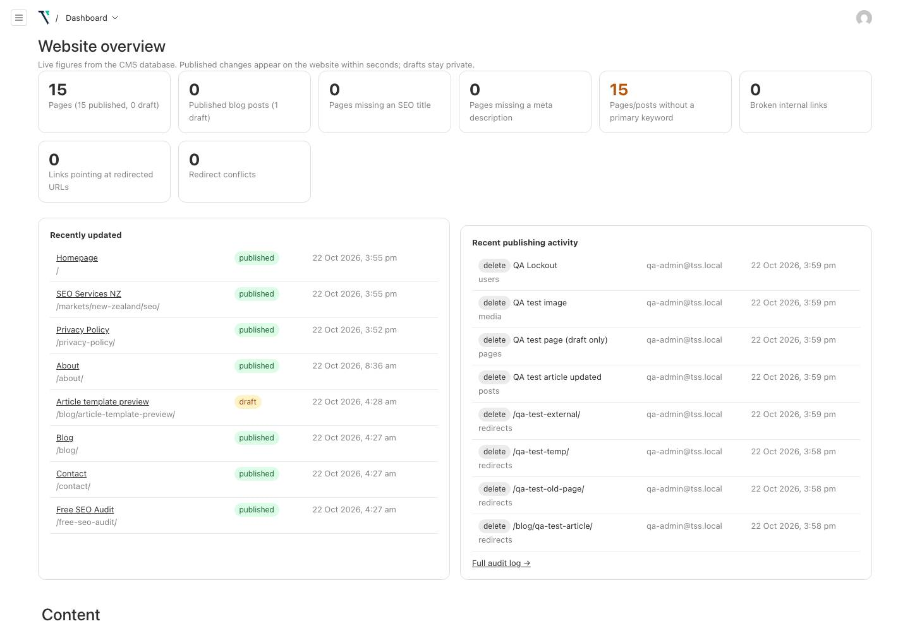

# Top Spot Studio — Final CMS QA re-check and handover report

Prepared 23 October 2026, 14:50 (UTC+6). Code on `main`: `7afffa2` ("Make Vercel Production indexable regardless of NEXT_PUBLIC_SITE_ENV"). This addendum updates [`FINAL-QA-REPORT.md`](FINAL-QA-REPORT.md) (22 Oct, tested `a330b97`).

## 1. Summary

**Production SEO now passes.** The critical issue from 22 Oct (OI-1: live site not indexable) is resolved. A read-only crawl of `https://topspotstudio.com` passed **156/156**, and typecheck and lint are clean.

The CMS, blog, redirect, form and auth suites (items 2–6) and the production build were **not re-run today**: this check was read-only (no server, CMS edits, form submissions or builds). Those results come from the 22 Oct run on the isolated Neon `qa` branch with a mock mail server. Nothing was deployed and nothing in production changed; every production request today was a GET.

## 2. Results by checklist item

| # | Checklist item | Result | Source |
| --- | --- | --- | --- |
| 1 | Production robots.txt, sitemap.xml, X-Robots-Tag, canonical | **PASS** | Live production, 23 Oct (§3) |
| 2 | Edit title, meta description, content; publish/unpublish | PASS (21/21) | 22 Oct, `qa` branch |
| 3 | Blog draft, preview, publishing workflow | PASS (17/17) | 22 Oct, `qa` branch |
| 4 | Redirects, internal links, broken-link detection | PASS (15/15 + 7/7) | 22 Oct, `qa` branch |
| 5 | Contact and audit forms to a mock destination | PASS (22/22 + 6 API checks) | 22 Oct, mock SMTP only |
| 6 | Admin authentication, permissions, audit log | PASS (44/44) | 22 Oct, `qa` branch |
| 7 | QA crawl, build, typecheck, mobile regression | Crawl, typecheck, lint **PASS** today; build and mobile PASS on 22 Oct; `npm test` not runnable | Mixed (§4) |
| 8 | Report with screenshots, pass/fail, unresolved issues | Done (this file) | — |

## 3. Production SEO (item 1) — live, 23 Oct

| Check | Result | Status |
| --- | --- | --- |
| `robots.txt` | `Allow: /` and `/cms-api/media/file/`; disallows `/api/`, `/admin/`, `/cms-api/`, `/preview/`, `/exit-preview/`; absolute sitemap URL | PASS |
| `sitemap.xml` | 200, 13 canonical URLs; `lastmod` values are real CMS update times (not the built-in fallback), so the production database connection works | PASS |
| Public pages (13) | 200, no `X-Robots-Tag`, `index, follow` plus `googlebot` preview directives, exactly one title, description and self-referencing canonical | PASS |
| Gated pages | `/blog/` and `/privacy-policy/` are `noindex, follow` (intentional launch gates) | PASS |
| Private routes | `/admin/`, `/cms-api/users/`, `/cms-api/audit-logs/`, `/preview/` send `noindex, nofollow`; the two APIs return 403 anonymously; preview redirects to login | PASS |
| Redirects | `www` → apex and `http` → `https`, both 308 | PASS |
| Unknown URL | 404 | PASS (see OI-7) |

## 4. Build and regression (item 7)

| Check | Command | Result | Date |
| --- | --- | --- | --- |
| Crawl and SEO (production) | `node scripts/check-site.mjs https://topspotstudio.com https://topspotstudio.com` | 156 passed, 0 failed, 0 warnings | 23 Oct |
| Types | `npx tsc --noEmit --incremental false` | 0 errors | 23 Oct |
| Lint | `npx eslint` | 0 errors, 4 warnings (OI-10) | 23 Oct |
| Build | `npm run build` | OK, 39 static pages | 22 Oct |
| Navigation | `npm run qa:nav` | 15/15 | 22 Oct |
| Mobile/tablet/desktop | `npm run qa:screens` (15 routes × 375/768/1440) | No console errors, failed requests or overflow | 22 Oct |
| Unit tests | `npm test` | Not runnable (OI-4) | 23 Oct |

## 5. Gap: latest commit not yet through the CMS suites

`7afffa2` was pushed after the 22 Oct run. It changes only environment detection, `robots.ts`, `sitemap.ts` (hourly revalidation and a fallback list if the CMS query fails), metadata and admin help text. The live checks in §3 cover its main effect, and publish events still revalidate `/sitemap.xml` and `/robots.txt`. Risk to CMS workflows is low, but suites 2–6 should be re-run on this commit before the `qa` branch expires on 29 Oct.

## 6. Unresolved issues

| ID | Severity | Issue | Owner action |
| --- | --- | --- | --- |
| OI-1 | — | **Resolved.** Production is indexable. | Submit the sitemap in Search Console. |
| OI-S | High (safety) | `.env.local` points at the **production** Neon branch (`ep-curly-surf`, `NEON_BRANCH=production`). `npm run dev` locally edits the live site. | Point local development at the `qa` branch. |
| OI-2 | High | Production SMTP: Gmail `535` login error in the 22 Oct build log. Forms and CMS password resets may fail. | Fix `SMTP_USER` / `SMTP_PASS` in Vercel, redeploy, send one real test enquiry (needs approval). |
| OI-3 | High | Durable media storage may be missing (`BLOB_READ_WRITE_TOKEN`). Uploads could be lost on the next deploy. | Connect a Vercel Blob store; avoid media uploads until then. |
| OI-4 | Medium | `npm test` runs Vitest, which isn't installed; no test files exist. | Install Vitest and add tests, or remove the script. |
| OI-11 | Medium | The `qa` database branch expires **29 Oct 2026**. | Re-run suites 2–6 on `7afffa2` before then. |
| OI-5 | Low | `CMS_EMAIL_FROM` must be a bare address; `.env.example` doesn't say so. | Set a bare address in Vercel. |
| OI-7 | Low | The 404 page has two robots meta tags (`noindex` and `noindex, follow`). No SEO harm. | Tidy the 404 template. |
| OI-12 | Low | `robots.txt` contains `Host: https://topspotstudio.com`, a non-standard line Google ignores. | Optional: remove `host` from `src/app/robots.ts`. |
| OI-10 | Low | 4 lint warnings (unused variables) in `raw/broken-link-test.mjs`. | Ignore `handover/` in ESLint or prefix the variables with `_`. |
| OI-6 | Low | Some `www` / `http` URLs take two redirect hops to reach the apex. | Optional: domain-level redirect in Vercel. |
| OI-8 | Info | Blog has 0 published posts; privacy policy gated. Intentional. | Publish ~3 posts and approve the policy, then flip the flags. |
| OI-9 | Info | 15 pages/posts have no primary keyword. | Editorial: fill in the SEO tab. |

## 7. Screenshots (22 Oct run)

Full sets: `screenshots/site/` (15 routes × 375/768/1440 px) and `screenshots/admin/`.

## 8. Next steps

1. Point `.env.local` (or a QA shell env) at the `qa` Neon branch.
2. Build `7afffa2` with QA settings, start the mock SMTP server, and run `scripts/cms-qa.mjs`, `raw/broken-link-test.mjs`, `qa:forms`, `qa:nav` and `qa:screens` (commands in `FINAL-QA-REPORT.md` §8).
3. Record the results here and close OI-11.

Production stays untouched unless the owner approves otherwise.
