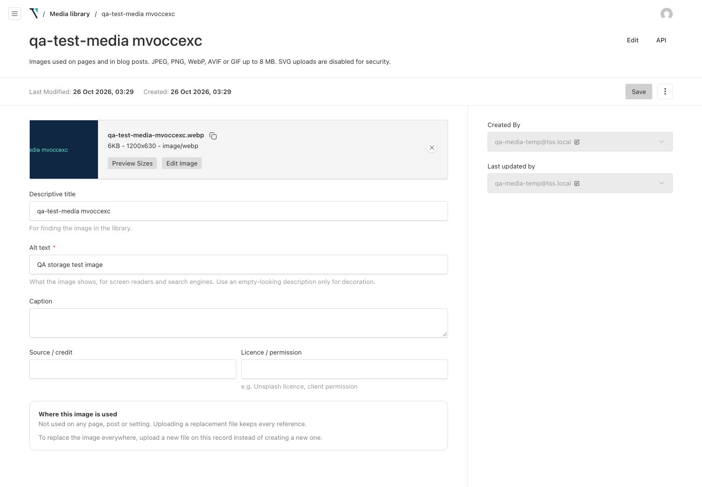

# Top Spot Studio — Production Readiness Report

Prepared 26 October 2026, 03:45 (UTC+6). Supersedes the open-issue lists in `../05-final-qa/FINAL-QA-REPORT.md` and `../05-final-qa/QA-RECHECK-2026-10-23.md`.

## Verdict

**Production-ready: PASS, with one owner confirmation outstanding.** All five priorities are complete, and every approved production change was applied and verified on the live site. Still open: the owner has not yet confirmed that the two real test emails arrived (Gmail's SMTP server accepted both), plus a few low-severity follow-ups (§2.2).

Production runs commit **`671a9b3`**, current deployment `dpl_5QR7418d1fu3zWZztwF3CDtcnVhN`, aliased to `https://topspotstudio.com`.

---

## 1. Resolved issues

| ID | Issue (from earlier reports) | Resolution | Evidence |
| --- | --- | --- | --- |
| OI-1 | Production SEO / `NEXT_PUBLIC_SITE_ENV` | `NEXT_PUBLIC_SITE_ENV` was **not set** in Vercel Production. Indexing already worked through `VERCEL_ENV` (since `7afffa2`). With approval, `NEXT_PUBLIC_SITE_ENV=production` was added for consistency. Live audit 48/48, crawl 156/156. | `logs/live-seo-after-deploy.log`, `logs/live-crawl-after-deploy.log` |
| OI-2 | SMTP `535 Username and Password not accepted` | Root cause: the Production `SMTP_PASS` was the wrong value (37 characters, not a 16-character Google App Password). It was replaced with the working App Password and is now stored as a Secret. The build log no longer shows `535`/`EAUTH`. Two real submissions returned `{"ok":true}`, so Gmail SMTP accepted both. | `logs/vercel-build-671a9b3.log`, `logs/live-form-test.log` |
| OI-3 | No durable media storage | Vercel Blob store `topspotstudio-media` is connected to Production only. **Found and fixed a blocker:** enabling Blob without a schema change breaks every upload (`column "_objectkey" does not exist`). Added `alwaysInsertFields` and the additive migration `20261025_195558_media_storage_fields`, applied to development, qa and production. | `logs/prod-migration.log`, `logs/prod-media-*.log` |
| OI-S | Local development used the production database | New Neon `development` branch for local work. Branch passwords rotated so development and QA credentials can't log in to production. A code guard refuses the production database outside Vercel Production. | §5, `../04-release/database-separation.md` |
| OI-4 | `npm test` broken (Vitest missing) | Vitest 3.2 installed, `vitest.config.ts` added, 22 unit tests (site environment, database guard, forms, paths, redirect rules). | `npm test` → 22/22 |
| OI-5 | `CMS_EMAIL_FROM` "Name <address>" breaks the CMS sender | Code now reduces it to the bare address; the Production value is also set to the bare address. QA reset mail shows `From: Top Spot Studio CMS <cms@example.com>`. | `logs/cms-qa.log` (AUTH-14) |
| OI-6 | `www`/`http` redirect chains | Vercel domain redirects (308) `www.topspotstudio.com` → `topspotstudio.com` and `topspotstudio.vercel.app` → `topspotstudio.com`. Canonical `www` URLs now take one hop. Two edge patterns remain at two hops (§2.2). | `logs/live-seo-after-deploy.log` |
| OI-7 | 404 page had two robots meta tags | Removed the explicit robots entry; Next.js injects the single `noindex`. Live: one tag. | `logs/live-seo-after-deploy.log` (404) |
| OI-8 | Launch gates | Blog: **unapproved** (0 published posts). It stays `noindex` and out of the sitemap, and the nav link stays visible (owner's choice). Privacy Policy: **approved** by the owner, so `NEXT_PUBLIC_PRIVACY_APPROVED=true`. It is now `index, follow` and in the sitemap (14 URLs). | `logs/live-seo-after-deploy.log` |
| OI-10 | Lint warnings in `handover/` | `handover/**` ignored by ESLint: 0 problems. | `npm run lint` |
| OI-11 | Latest commit not through the CMS suites | All suites re-run on the final code against the `qa` branch (§6). | `logs/cms-qa.log` etc. |
| OI-12 | Non-standard `Host` line in robots.txt | Removed. | `logs/live-seo-after-deploy.log` |
| — | CMS updates in public HTML | All 15 published pages: `<title>`, meta description, canonical, robots and block headings in the live server-rendered HTML match the CMS. The QA suite also edits, publishes and unpublishes content and checks the server HTML (EDIT, SEO, PUB). | `logs/cms-render-parity-after-deploy.log` |

## 2. Remaining items

### 2.1 Owner action

| Item | Status | Action |
| --- | --- | --- |
| Inbox confirmation for the real test emails | Gmail SMTP accepted both (HTTP 200 `{"ok":true}`; the handler returns 502 on any send failure). Not yet confirmed in the inbox. | Search the CONTACT_INBOX Gmail (and Spam) for **`PT-202610252127`**. Expect 2 messages: "New enquiry — Production test PT-202610252127" and "Free SEO audit request — https://example.com". |
| Search Console | — | Submit `https://topspotstudio.com/sitemap.xml` (now 14 URLs including the Privacy Policy). |

### 2.2 Known low-severity items (no blocker)

| Item | Detail | Recommendation |
| --- | --- | --- |
| Deleted images stay in the CDN cache | Payload's Blob file route sends `Cache-Control: public, max-age=31536000`. After the test image was deleted, the origin returned **404** but the Vercel CDN still served a cached copy (`x-vercel-cache: HIT`). Only the harmless QA test rectangle is affected, at an unguessable URL. | When an image must disappear immediately, run Vercel → Settings → Caches → Purge CDN cache (or `vercel cache purge`). Optionally lower `cacheControlMaxAge` in `vercelBlobStorage`; this also affects images replaced in place under the same filename. |
| Two-hop redirect edge cases | `https://www…/about` (no trailing slash) → apex `/about` → `/about/`; `http://www…/` → `https://www…/` → apex. Vercel applies the https upgrade and the domain redirect before the site's trailing-slash rule. All hops are 308 and end on the canonical URL. | None needed (canonical URLs and all internal links take at most one hop). |
| Resized images are PNG | `formatOptions` converts only the original to WebP; the thumbnail, card and hero sizes keep the source format (PNG uploads give PNG sizes). | Optional: add `formatOptions` to each `imageSizes` entry in `Media.ts`. |
| `qa` Neon branch expires 29 Oct | Intentional; `development` never expires. | Create a fresh QA branch per test run (`../04-release/database-separation.md`). |
| Vercel Preview has no environment variables | Preview deployments would have no database or SMTP. | If previews are wanted, add a Neon preview branch and Preview-scoped variables (never the production database; the guard refuses it). |
| CLI-created users aren't audit-logged | `cms:create-admin` and server-side deletes bypass the audit hooks. The temporary test account's logins and media actions were logged. | Optional: log user create/delete in the script. |
| Analytics | GTM is live in Production, so the two test submissions (25 Oct 21:27 UTC) may appear as form conversions. | Exclude them in GA4 if needed. |
| OI-9 | 15 pages/posts have no primary keyword (editorial). | Fill in the SEO tab. |

## 3. Production deployment and configuration changes

All approved by the owner on 26 Oct. In order of execution (UTC, 25 Oct):

| # | Time | Change | Rollback |
| --- | --- | --- | --- |
| 1 | 21:17 | **Database migration** `20261025_195558_media_storage_fields` on Neon `production`: adds `media.prefix varchar DEFAULT ''` and `media._objectkey varchar` (additive, 0 media rows). Neon restore point: `2026-10-25T21:17:48Z`. | `migrate:down` for this migration, or Neon point-in-time restore |
| 2 | ~21:19 | **Vercel Production env**: `SMTP_PASS` replaced (now Secret), `CMS_EMAIL_FROM` = bare SMTP address, `NEXT_PUBLIC_PRIVACY_APPROVED=true`, `NEXT_PUBLIC_SITE_ENV=production` (new) | Edit in Vercel and redeploy |
| 3 | ~21:20 | **Vercel Blob** store `topspotstudio-media` (`store_Xifb2aMGrw33hOWj`, iad1, public), connected to Production only → `BLOB_READ_WRITE_TOKEN` (Production) | Disconnect the store; uploads fall back to the read-only disk (fail) |
| 4 | 21:22 | **Code**: pushed `671a9b3` to `main` → Vercel Production build `topspotstudio-4h9zhv4da` (Ready, 40 s build) | Promote `topspotstudio-ahm3f3oe8` (`7afffa2`) |
| 5 | ~21:25 | **Domains**: `www.topspotstudio.com` and `topspotstudio.vercel.app` set to redirect (308) to `topspotstudio.com` | Clear the redirect in Vercel → Domains |
| 6 | 21:27 | **Real email test**: 1 contact + 1 audit submission through the live forms | — |
| 7 | 21:29–21:35 | **Production media test**: temporary admin `qa-media-temp@tss.local` created; 1 image uploaded; **one redeploy** of `671a9b3` (`dpl_5QR7418d1fu3zWZztwF3CDtcnVhN`, now live); image verified; image, Blob files, temporary admin and its orphaned UI-preference row deleted | — |

**Commit `671a9b3`**: Blob media columns and migration; production-database guard (`src/lib/db-guard.ts`); `CMS_EMAIL_FROM` normalisation; 404 single robots tag; robots.txt without `Host`; Vitest and 22 unit tests; QA tools (`scripts/live-seo-check.mjs`, `scripts/cms-render-parity.mjs`, `scripts/media-storage-qa.mjs`); database-separation doc; QA evidence. Production dependencies are unchanged: the lockfile only adds Vitest's dev packages (0 version changes).

**Production data after all work** compared with the session start (`raw/prod-row-counts-before.json` → `raw/prod-row-counts-final.json`): pages, posts, users (1) and media (0) are unchanged, and the latest page/post update times are unchanged. `audit_logs` 9 → 16 (the test's logins plus media create/update/delete), `payload_migrations` 1 → 2.

**Non-production changes**: Neon branch `development` created; `neondb_owner` password reset on `development` and `qa` only; QA Blob store `topspotstudio-media-qa` (`store_KgKzNq6S5A8PWh30`) connected to the Vercel Development environment only; `.env.local` switched to `development`; Neon CLI context set to `development`. On this machine, the Vercel CLI is logged in and `.vercel/` (git-ignored) links the project. Run `npx vercel logout` if that access isn't wanted.

**Not pushed**: a follow-up commit with this report, the final logs, `scripts/live-form-test.mjs` and small script options (`PRIVACY_APPROVED` in `live-seo-check.mjs`, `ALLOW_PRODUCTION_MEDIA_QA` in `media-storage-qa.mjs`). It only touches docs and scripts, but pushing to `main` triggers a Production deploy, so it awaits approval.

## 4. Live SEO crawl (after deploy, 25 Oct ~21:26 UTC)

| Check | Result |
| --- | --- |
| `robots.txt` | 200; `Allow: /` and `/cms-api/media/file/`; disallows `/api/`, `/admin/`, `/cms-api/`, `/preview/`, `/exit-preview/`; absolute sitemap URL; no `Host`; no `X-Robots-Tag` |
| `sitemap.xml` | 200, **14** canonical `https://topspotstudio.com/…/` URLs (13 before plus the approved Privacy Policy); blog excluded |
| Public pages (14) | 200, **no `X-Robots-Tag`**, meta robots `index, follow` (+ googlebot preview directives), exactly one title, description and self-referencing canonical |
| Gated | `/blog/` → `noindex, follow` (intentional, blog unapproved) |
| Private | `/admin/` `noindex, nofollow`; `/cms-api/users/` and `/cms-api/audit-logs/` → 403 + `noindex, nofollow`; `/preview/` → 307 to login + `noindex, nofollow`; `/api/contact/`, `/api/audit/` GET → 405; robots.txt disallows all of them |
| 404 | 404 status, one robots tag (`noindex`) |
| Redirects | `www` → apex 308 (1 hop for canonical URLs); `http` → `https` 308; non-slash → slash 308 |
| Totals | Live SEO audit **48/48**; full crawl **156/156** (0 warnings); CMS-to-HTML parity **15/15** |

Before the deploy, the same audit scored 45/47; the two failures were the `Host` line and the duplicate 404 tag (`logs/live-seo-before-changes.log`).

## 5. SMTP and media storage

### SMTP

| Check | Result |
| --- | --- |
| Diagnosis | Login-only check (`verify()`, no mail sent): local credentials **OK**; Production credentials **535**. Same username in both, different password value (37 characters instead of 16 + spaces). |
| Sender address | `FORM_FROM_EMAIL`, `SMTP_USER` and `CONTACT_INBOX` are the same Gmail account, so Gmail accepts it as the sender. `CMS_EMAIL_FROM` is now that bare address. |
| Production build | No `535`/`EAUTH` (Payload verifies the transport during the build; the 22 Oct build failed this check) |
| Real contact submission | HTTP 200 `{"ok":true}`, success message shown |
| Real audit submission | HTTP 200 `{"ok":true}`, success message shown |
| Inbox receipt | **Pending owner confirmation** (ID `PT-202610252127`) |
| QA (mock SMTP) | 2 audit + 2 contact + password-reset mails delivered only to the mock inbox; forms 22/22 |

### Media storage

| Check | QA (`topspotstudio-media-qa`) | Production (`topspotstudio-media`) |
| --- | --- | --- |
| Upload (admin, 1200×630 image) | PASS (201) | PASS (201) |
| Original + 3 sizes served via `/cms-api/media/file/…` | PASS (4/4) | PASS (4/4) |
| Files present in the Blob store | PASS (4 objects) | PASS (4 objects) |
| Direct Blob CDN URL reachable | PASS | PASS |
| Persistence | PASS after deleting `.next` and a clean rebuild + restart, byte-identical | PASS after a **Vercel redeploy** (`dpl_5QR7418d…`), byte-identical |
| Delete removes record and Blob files | PASS (0 left) | PASS (0 left) |
| Deleted URL returns 404 | PASS | Origin 404; CDN cached copy still served (§2.2) |
| CMS suite media checks (validation, SVG/disguised files rejected, anonymous upload denied) | 7/7 with Blob enabled | — |

## 6. Database isolation

| Layer | Status |
| --- | --- |
| Separate branches | `production` (`ep-curly-surf-b49furta`, Vercel Production only), `development` (`ep-round-waterfall-b467le23`, local), `qa` (`ep-weathered-smoke-b4nzp73w`, test runs) |
| Separate credentials | Before: development/qa password **identical** to production (Neon copies roles into child branches). After the reset on development and qa: all three differ (verified by comparison, without printing them) |
| Local config | `.env.local` → `development` (pooled and direct). Neon CLI default branch → `development`. No production connection string remains in the workspace (scanned) |
| Code guard | `assertDatabaseAllowed()` in `payload.config.ts` refuses the production endpoint unless `VERCEL_ENV=production` or `ALLOW_PRODUCTION_DB=true`. Verified against the real production URL locally: refused before connecting. 4 unit tests. The CMS QA suite also refuses `topspotstudio.com` |
| Tests didn't touch production | All QA suites ran on `qa`. Production row counts were identical before and after the QA phase (`raw/prod-row-counts-before.json` = `raw/prod-row-counts-after.json`) |
| Documentation | `../04-release/database-separation.md` (no credentials) |

## 7. Final pass/fail checklist

| # | Requirement | Result | Evidence |
| --- | --- | --- | --- |
| 1.1 | Verify `NEXT_PUBLIC_SITE_ENV` in Vercel Production | PASS (was unset) | `vercel env ls` (§1) |
| 1.2 | Prepare and apply the correction, redeploy | PASS (`=production` added; deploy `671a9b3`) | §3 |
| 1.3 | Live robots.txt, sitemap, X-Robots-Tag, meta robots, canonical | PASS 48/48 | `logs/live-seo-after-deploy.log` |
| 1.4 | Production crawl: all intended public pages indexable | PASS 156/156; 14/14 sitemap pages `index, follow` | `logs/live-crawl-after-deploy.log` |
| 1.5 | Admin, API, preview, gated pages protected | PASS | §4 |
| 2.1 | Fix SMTP authentication | PASS | `logs/vercel-build-671a9b3.log` (0 × 535) |
| 2.2 | Verify sender address | PASS | §5 |
| 2.3 | One real contact test, one real audit test | PASS (accepted by Gmail SMTP); inbox receipt **pending owner** | `logs/live-form-test.log` |
| 3.1 | Durable media storage | PASS (Vercel Blob, Production only) | §3 |
| 3.2 | Upload, retrieval, persistence across deployments | PASS (QA and Production) | `logs/media-*.log`, `logs/prod-media-*.log` |
| 4.1 | Production DB removed from routine local development | PASS | §6 |
| 4.2 | Isolated development/QA database | PASS | §6 |
| 4.3 | Dev/QA cannot modify production | PASS (separate hosts, separate passwords, code guard) | §6 |
| 4.4 | Documented without credentials | PASS | `../04-release/database-separation.md` |
| 5.1 | Test script fixed | PASS (`npm test` 22/22) | `npm test` |
| 5.2 | Redirect chains and 404 metadata reviewed | PASS (domain redirects; single 404 tag; 2 edge cases documented) | §2.2, §4 |
| 5.3 | Blog / privacy gates match approval status | PASS (blog gated; privacy indexable per approval) | §1 OI-8 |
| 5.4 | Published CMS updates appear in public server HTML | PASS (live parity 15/15; QA EDIT/SEO/PUB suites) | `logs/cms-render-parity-after-deploy.log`, `logs/cms-qa.log` |

### QA regression on the final code (`qa` branch, mock SMTP, Blob enabled)

| Suite | Result |
| --- | --- |
| CMS end-to-end (`scripts/cms-qa.mjs`) | **120/120** (`logs/cms-qa.log`; earlier runs on the same day: run 1 failed AUTH-14 because the script read the wrong mock-log path, fixed; run 2 failed AUTH-10/15 because the in-memory login limiter wasn't reset between runs, fixed by restarting the server) |
| Broken-link detection | 7/7 |
| Forms (375 and 1440 px) | 22/22 |
| Navigation | 15/15 |
| Crawl (local, production settings) | 156/156 |
| Responsive screenshots (15 routes × 375/768/1440) | No console errors, failed requests or overflow (`screenshots/site/`) |
| Media storage (`scripts/media-storage-qa.mjs`, 17 checks) | 17/17 QA; 16/17 production (the failure: deleted image still served from the CDN cache, §2.2) |
| Unit tests / lint / typecheck / build | 22/22 / 0 problems / 0 errors / OK (39 pages) |

## 8. Evidence index

- `logs/`: every run above, including both Vercel build logs (`vercel-build-671a9b3.log`, `vercel-build-redeploy.log`) and the production migration log.
- `raw/`: CMS suite JSON, live SEO JSON (before and after), CMS parity JSON, production row counts (before, after QA, final).
- `screenshots/`: production and QA media evidence, Link Manager broken-link detection, `site/` (45 responsive screenshots).
- Reusable tools: `scripts/live-seo-check.mjs` (read-only), `scripts/cms-render-parity.mjs` (read-only), `scripts/media-storage-qa.mjs` (refuses production unless `ALLOW_PRODUCTION_MEDIA_QA=true`), `scripts/live-form-test.mjs` (sends real email only with `CONFIRM_REAL_EMAIL=true`).
